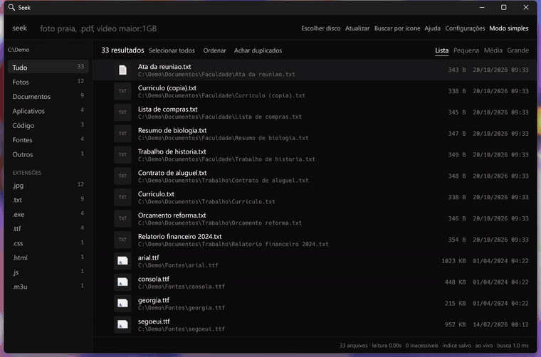
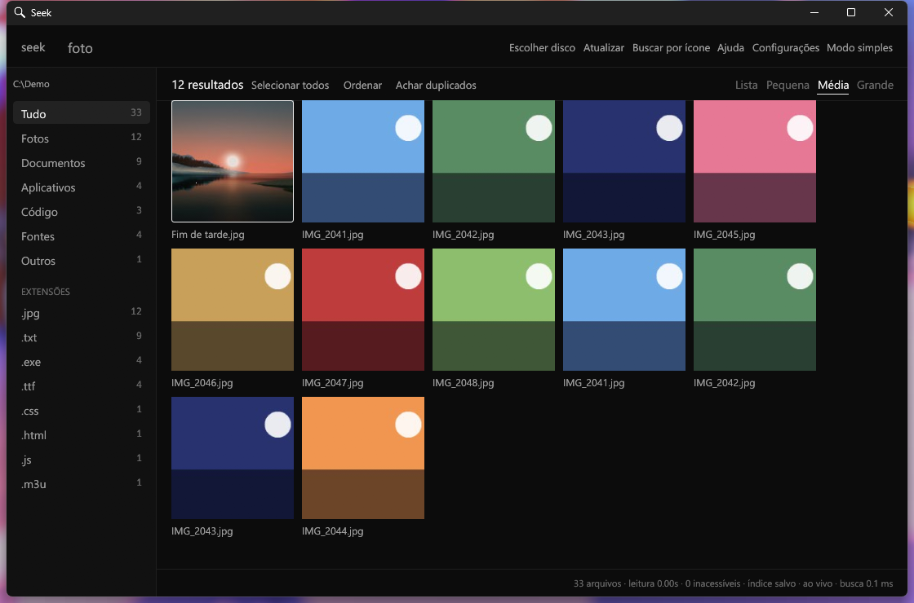
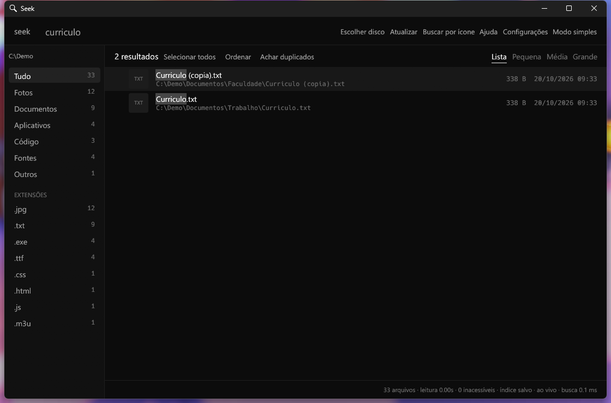
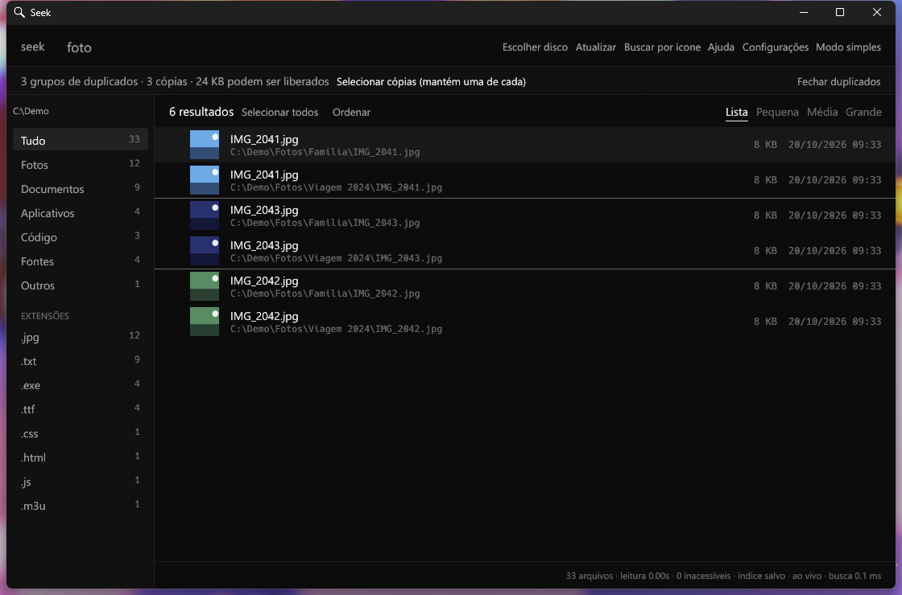
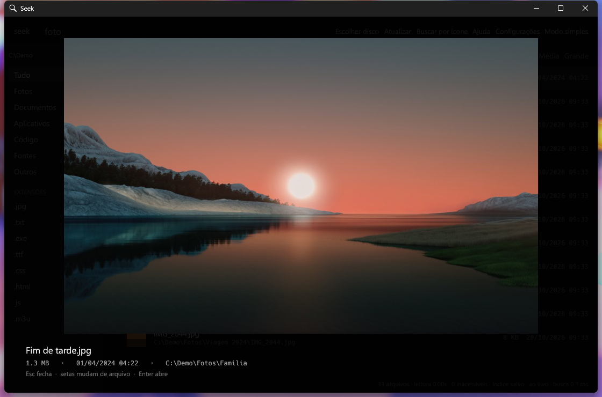
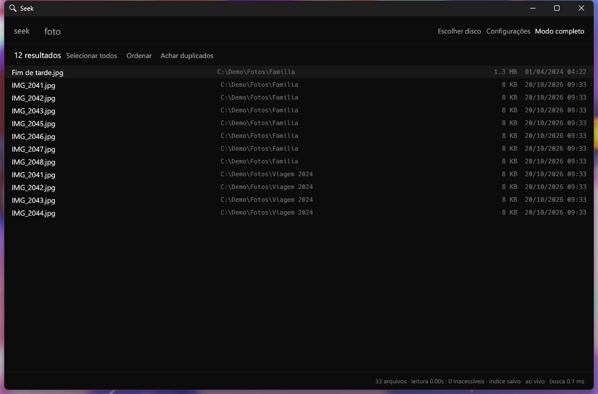
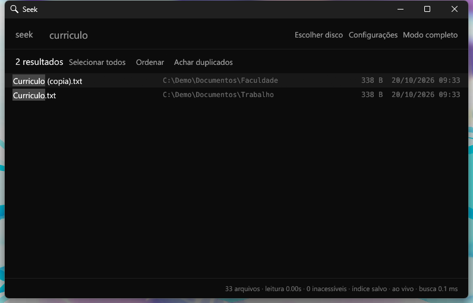
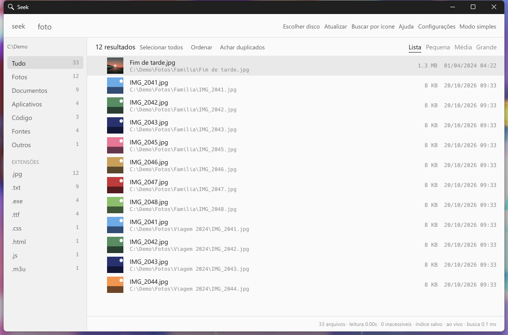
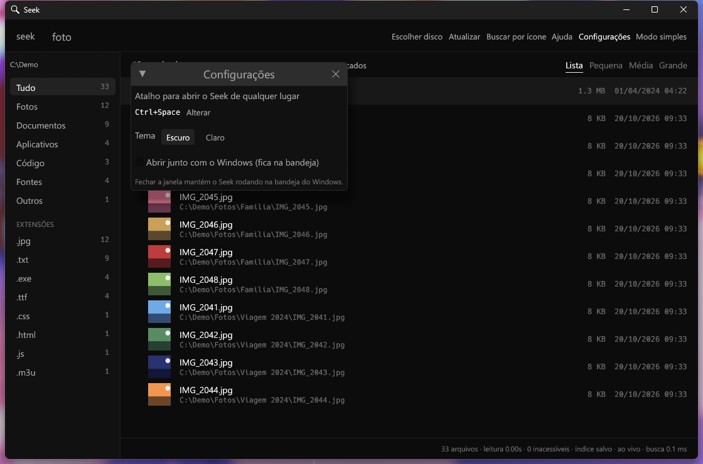

<div align="center">

# Seek

**Ache qualquer arquivo do seu computador em milissegundos.**

Buscador de arquivos para Windows, feito para quem tem milhões de arquivos e não lembra onde guardou um.

[](https://github.com/inflzzz/seek/releases/latest)
[](https://github.com/inflzzz/seek/releases)


### Baixe o Seek.exe na aba **Releases** deste repositório

Um arquivo só. Não precisa instalar. Atualiza sozinho.

<br>



<sub>Prefere em vídeo? <a href="docs/demo.mp4">docs/demo.mp4</a></sub>

</div>

---

## Por que o Seek

- **Instantâneo.** A busca acontece na memória: poucos milissegundos, mesmo com 1 milhão de arquivos.
- **Lê o disco inteiro em segundos.** Como administrador, o Seek lê a tabela interna do NTFS (a MFT) e indexa 1 milhão de arquivos em cerca de 6 segundos.
- **Sempre atualizado.** Acompanha o disco ao vivo: arquivo criado, apagado ou renomeado já aparece na busca.
- **Fica na bandeja.** Fechar a janela não encerra o programa. **Ctrl + Espaço**, de qualquer lugar, abre a janelinha de busca.
- **Ache pelo que você lembra.** Pelo nome, pela extensão (qualquer uma), pelo tipo, pelo tamanho, pela data, e até por **foto parecida** ou **ícone parecido**.
- **Privado.** Tudo roda no seu computador. O Seek lê nomes, pastas, tamanhos e datas. Nada é enviado para a internet.

## Veja em ação

<table>
  <tr>
    <td width="50%"><br><b>Fotos com miniatura</b><br>Lista, pequena, média ou grande. Vídeos e fotos de celular (HEIC) também.</td>
    <td width="50%"><br><b>Busca com destaque</b><br>O trecho encontrado fica marcado no nome, e a lista mostra pasta, tamanho e data.</td>
  </tr>
  <tr>
    <td><br><b>Achar duplicados</b><br>Compara o conteúdo, agrupa as cópias e mostra quanto espaço dá para liberar. Só move, nunca apaga.</td>
    <td><br><b>Prévia rápida</b><br>F3 mostra a imagem, o vídeo ou o começo do texto. As setas trocam de arquivo.</td>
  </tr>
  <tr>
    <td><br><b>Modo simples</b><br>Só a busca e uma linha por arquivo, no estilo Everything.</td>
    <td><br><b>Janelinha com Ctrl + Espaço</b><br>Abre de qualquer programa, Enter abre o primeiro resultado, Esc esconde.</td>
  </tr>
  <tr>
    <td><br><b>Tema escuro ou claro</b></td>
    <td><br><b>Configurações</b><br>Troque o atalho, o tema e abra o Seek junto com o Windows.</td>
  </tr>
</table>

## Primeiros passos

1. Baixe o `Seek.exe` na aba **Releases** deste repositório e abra.
2. Clique em **Escolher disco** (ou **Todos os discos**) e espere a primeira leitura.
3. Digite. Pronto.

> **Windows mostrou "app desconhecido"?** O Seek ainda não tem assinatura digital, então o SmartScreen avisa na primeira vez. Clique em **Mais informações → Executar assim mesmo**.

## O que dá para buscar

| Digite | Encontra |
|---|---|
| `curriculo` | Arquivos com essa palavra no nome ou na pasta |
| `foto praia` | Fotos com `praia` no nome ou na pasta (todas as palavras precisam aparecer) |
| `.png`, `.xyz` | Só aquela extensão. **Qualquer extensão funciona**, mesmo as raras |
| `vídeo maior:100MB` | Vídeos maiores que 100 MB (`menor:` para o contrário) |
| `modificado:hoje` | Alterados hoje. Também `ontem`, `semana`, `mes`, `ano`, `2023`, `2023-05` |
| `modificado:2023-01..2023-06` | Intervalo de datas. Também `>2023-01-01` e `<2023`. `criado:` funciona igual |
| `app`, `código`, `design`, `dados`, `fonte` | Categorias inteiras (13 no total) |
| `foto -ext:png` | Fotos, exceto PNG |
| `.jpg \| .png` | JPG **ou** PNG |
| `"viagem praia"` | A frase exata |

Maiúsculas e acentos não fazem diferença. A lista **Extensões**, na lateral, mostra todas as extensões que existem no seu disco, com a quantidade de cada uma, e sugere ao digitar `.p`.

## Atalhos

| Atalho | O que faz |
|---|---|
| **Ctrl + Espaço** | Abre a janelinha de busca de qualquer lugar (dá para trocar nas Configurações) |
| **Enter** | Abre o arquivo selecionado |
| **F3** (ou **Espaço** fora do campo) | Prévia grande |
| **↑ ↓ PageUp PageDown** | Movem o cursor pela lista |
| **Ctrl + Shift + C** | Copia o caminho do arquivo |
| **Ctrl + rolagem** | Muda o tamanho das miniaturas |
| **Esc** | Fecha a prévia ou esconde a janelinha |

## Buscar semelhantes

Botão direito num arquivo, **Buscar semelhantes**:

- **Nome parecido:** `IMG_2048` acha `IMG_2049`, `IMG_2051`...
- **Foto parecida:** fotos com composição e cores parecidas (cópias, versões redimensionadas). Não reconhece pessoas nem objetos.
- **Ícone parecido:** arquivos com o mesmo ícone.

## Perguntas frequentes

**Preciso ser administrador?**
Não. Mas, como administrador e em disco NTFS, a primeira leitura leva segundos em vez de minutos. O Seek avisa na barra de baixo e oferece **Leitura turbo: reabrir como administrador**.

**O Seek lê o conteúdo dos meus arquivos?**
Não. Ele lê nomes, pastas, tamanhos e datas. A única exceção é o **Achar duplicados**, que compara o conteúdo dos arquivos que você pediu, só no seu computador, e só quando você clica.

**Como o Seek se atualiza?**
Ao abrir e a cada 6 horas, ele confere aqui no GitHub se há versão nova, baixa, confere a integridade (SHA-256) e troca o arquivo. A nova versão vale na próxima abertura.

**Como fecho o programa?**
Fechar a janela só a guarda na bandeja do Windows. Para fechar de verdade: ícone da bandeja, botão direito, **Fechar**.

**Como desinstalo?**
Feche o Seek pela bandeja e apague o `Seek.exe` e a pasta `indices` ao lado dele. Se ativou "Abrir junto com o Windows", desligue antes em Configurações.

**Qual o consumo de memória?**
Cerca de 400 MB para cada 1 milhão de arquivos indexados.

**Funciona em disco de rede, pen drive, HD externo?**
Pen drives e HDs externos entram em **Todos os discos**. Pasta de rede você escolhe como pasta (sem a leitura turbo).

## Limites

- Só Windows 10 e 11, 64 bits. A interface está em português.
- Não procura dentro dos arquivos nem recupera arquivos apagados.
- Miniaturas de PDF e Office só aparecem se o Windows tiver o programa que as gera; RAW e HEIC dependem dos codecs instalados.

## Código aberto

O Seek é software livre, sob a [licença MIT](LICENSE). O código-fonte (Rust) está neste repositório.

Para compilar você precisa do [Rust](https://rustup.rs) (edição 2024) no Windows:

```
cargo build --release
```

O programa sai em `target/release/Seek.exe`. Para rodar os testes: `cargo test`.

Visão geral do código, em `src/`:

| Arquivo | O que faz |
|---|---|
| `lib.rs` | Motor: índice, busca, filtros, ordenação, duplicados, arquivos parecidos |
| `mft.rs` | Leitura direta da tabela de arquivos do NTFS (MFT) |
| `watch.rs` | Acompanha o disco ao vivo (arquivo criado, apagado, renomeado) |
| `ui.rs`, `main.rs` | Interface (egui) e aplicativo |
| `tray.rs`, `hotkey.rs` | Bandeja do sistema e atalho global |
| `icon_search.rs`, `thumbs.rs`, `shellthumb.rs` | Ícones, miniaturas e busca por ícone/foto parecida |
| `update.rs` | Atualização automática pelas Releases do GitHub (confere SHA-256) |

Contribuições são bem-vindas: abra uma issue ou um pull request.

---

## Versões

Veja as [versões publicadas](https://github.com/inflzzz/seek/releases) com as novidades de cada uma.

---

<div align="center"><sub>Seek · feito em Rust · os arquivos do seu computador ficam no seu computador</sub></div>
